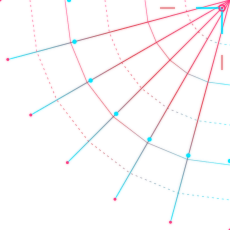

<div align="center">




<br clear="all"/>


<br/>


<br/>


</div>

<br/>


<h2 align="center"></h2>

<table>
<tr>
<td width="60%" valign="top">

<p> Maputo, Moçambique</p>

```yaml
core:
  nome: "Jeffrey William Junior"
  alias: "J3ffreyJr"
  funcao: "Web Developer / Software Engineer Jr."
  localizacao: "Maputo, Moçambique (MZ)"
  formacao: "Licenciatura em Engenharia e Ciência dos Computadores — ISUTC (3º ano)"
  idiomas: ["Português (nativo)", "Inglês (intermediário)"]

manifesto: >
  Construo sistemas funcionais e polidos — do backend
  em Java/Spring Boot a experiências web criativas.
  Cada projeto é um novo módulo carregado no sistema.

protocolos_ativos:
  - "Hackathons (M-Pesa Finckathon / Vodacom MiniFinckathon)"
  - "Extended Reality (Unity / Unreal Engine)"
  - "Arquitetura de estruturas de dados"

status: "[ONLINE] — tecendo novos módulos..."
```

</td>
<td width="40%" valign="top" align="center">


<p><a href="https://github.com/J3ffreyJr"><b>Ver perfil GitHub</b></a></p>

</td>
</tr>
</table>


<h2 align="center"></h2>

<div align="center">

**Front-End**
<br/>


<br/><br/>

**Back-End**
<br/>


<br/><br/>

**Linguagens**
<br/>


<br/><br/>

**Ferramentas & Ambiente**
<br/>


</div>


<h2 align="center"></h2>

<table width="100%">
<tr>
<td width="33%" valign="top">

###  Urban Nav
Motor de navegação urbana para Maputo com dados reais do OpenStreetMap.

`Java` `Spring Boot` `Leaflet.js` `Dijkstra` `BFS/DFS`

Grafo com centenas de milhares de nós, cálculo de rotas, POIs, GPS e API REST.


</td>
<td width="33%" valign="top">

###  Hospital HeJeGuMi
Sistema de gestão hospitalar com estruturas de dados implementadas manualmente.

`Java` `Spring Boot` `Hash Table` `Heap` `Filas`

Fila FIFO, heap de prioridades, lista duplamente ligada e tabela hash, do zero.


</td>
<td width="33%" valign="top">

###  Txigital
App de literacia financeira gamificado em RPG — M-Pesa Finckathon.

`Gamificação` `Xitique Digital` `Bilingue` `M-Pesa`

4 arquétipos moçambicanos, poupança em grupo e tema adaptativo dark/light.


</td>
</tr>
</table>

<div align="center">
<i>Portfólio completo -&gt;</i> <a href="https://jeffrey-portifolio.netlify.app"><b>jeffrey-portifolio.netlify.app</b></a>
</div>


<h2 align="center"></h2>

```bash
J3ffreyJr@SUIT-OS:~$ cat objetivos_2026.log

[~] Explorar IA
[~] Aprofundar arquitetura full-stack
[~] Expandir portfólio com novos projetos de impacto local
[ ] Contribuir para projetos open-source
[ ] Aplicar a estágios/vagas em dev web

J3ffreyJr@SUIT-OS:~$ echo "sempre a compilar, sempre a aprender_"
```


<h2 align="center"></h2>

<div align="center">


<p>
  <a href="https://github.com/J3ffreyJr?tab=repositories"><b>Projetos públicos</b></a>
  &nbsp;|&nbsp;
  <a href="https://github.com/J3ffreyJr?tab=overview"><b>Contribuições</b></a>
  &nbsp;|&nbsp;
  <a href="https://github.com/J3ffreyJr"><b>Perfil GitHub</b></a>
</p>

</div>

<h2 align="center"></h2>

<div align="center">


<p><a href="https://github.com/J3ffreyJr?tab=achievements"><b>Ver conquistas no GitHub</b></a></p>

</div>

<h2 align="center"></h2>

<div align="center">

<picture>
  <source media="(prefers-color-scheme: dark)" srcset="https://raw.githubusercontent.com/J3ffreyJr/J3ffreyJr/output/github-contribution-grid-snake-suitos-dark.svg" />
  <source media="(prefers-color-scheme: light)" srcset="https://raw.githubusercontent.com/J3ffreyJr/J3ffreyJr/output/github-contribution-grid-snake-suitos.svg" />
  
</picture>

<sub>Pacote de dados cyan percorrendo o grid — preto -&gt; vermelho Iron Spider -&gt; magenta bio-elétrico -&gt; cyan HUD.</sub>

</div>


<h2 align="center"></h2>

<div align="center">

<a href="https://www.linkedin.com/in/jeffrey-william-junior-4a1657235" target="_blank">

</a>
<a href="https://www.instagram.com/jeffrey_jr._/" target="_blank">

</a>
<a href="mailto:jeffwilljr05@gmail.com" target="_blank">

</a>
<a href="https://jeffrey-portifolio.netlify.app" target="_blank">

</a>

</div>

<br/>

<div align="center">


<sub>Feito com <b style="color:#00E5FF">&lt;/&gt;</b> em Maputo, Moçambique — © 2026 Jeffrey William Jr.</sub>

</div>
